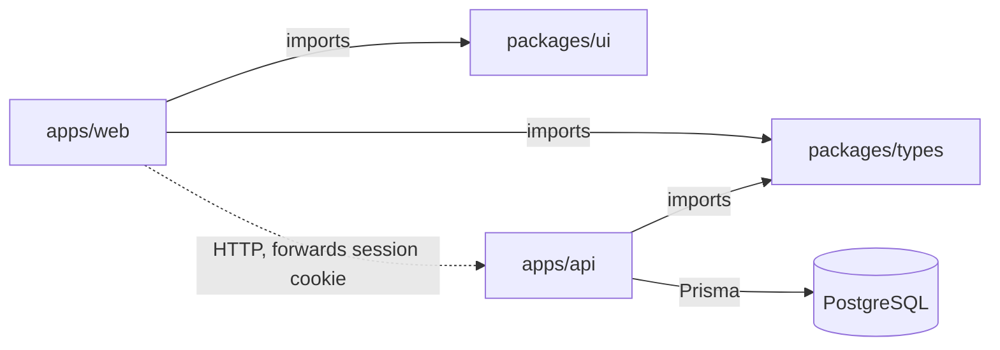
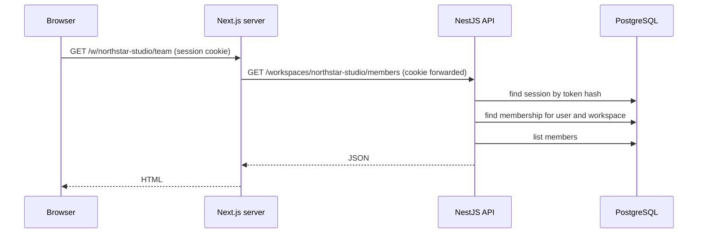

# Architecture

## Packages

| Package | Job | Depends on |
| --- | --- | --- |
| [packages/types](../packages/types) | Roles, the permission matrix, and the shapes of API responses | nothing |
| [packages/ui](../packages/ui) | Design tokens and base components | nothing |
| [apps/api](../apps/api) | NestJS REST API. The only code that touches the database. | types |
| [apps/web](../apps/web) | Next.js app. Everything the browser sees. | types, ui |

The two apps never import each other. They share only the two packages, and
talk over HTTP.

## One request, end to end

Opening the Team page:

| Step | File | What happens |
| --- | --- | --- |
| 1 | [team/page.tsx](../apps/web/src/app/w/[workspaceSlug]/team/page.tsx) | Runs on the server. Asks for the session and the members. |
| 2 | [session.ts](../apps/web/src/lib/session.ts) | Looks up the session once per request. Redirects to sign-in if there is none. |
| 3 | [api.ts](../apps/web/src/lib/api.ts) | Reads the session cookie and forwards it to the API. |
| 4 | [auth.guard.ts](../apps/api/src/auth/auth.guard.ts) | Turns the cookie into a user, or answers 401. Applies to every route not marked `@Public()`. |
| 5 | [workspace.guard.ts](../apps/api/src/workspaces/workspace.guard.ts) | Checks the user is a member of the workspace in the URL and has the required role. |
| 6 | [members.service.ts](../apps/api/src/team/members.service.ts) | Queries the database through Prisma. |

Reading those files in order is the quickest way to see how the system fits
together.

## Changing data

Forms in the web app call server actions in
[apps/web/src/lib/actions](../apps/web/src/lib/actions). A server action runs
on the Next.js server, calls the API the same way a page does, and returns
either an error message for the form or a redirect.

Sign-in is the one special case: the action reads the session token from the
API's response and sets it as a cookie on the web app's own origin.

## Database

The schema is [apps/api/prisma/schema.prisma](../apps/api/prisma/schema.prisma).
Phase 1 has five tables:

| Table | Holds |
| --- | --- |
| User | Account with a hashed password |
| Session | One row per signed-in browser, storing a hash of the session token |
| Workspace | Name and unique slug |
| Membership | Links a user to a workspace with a role |
| Invitation | Email, role, expiry and a hash of the invite token |

## Loading boundaries in the web app

Each section under `/w/[workspaceSlug]` has its own `loading.tsx`. A boundary
in the shared workspace layout is already on screen when moving between
sections, so Next.js does not count it, and reports an "uncached data" error
in development. A new section needs a one-line `loading.tsx` that re-exports
[the shared one](../apps/web/src/app/w/[workspaceSlug]/loading.tsx).
